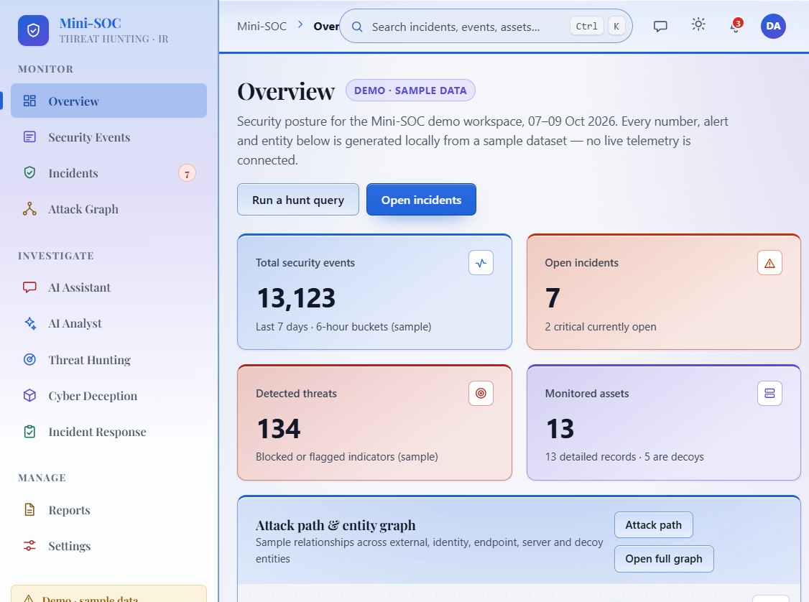
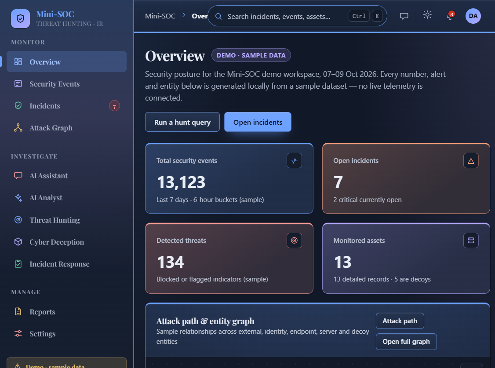
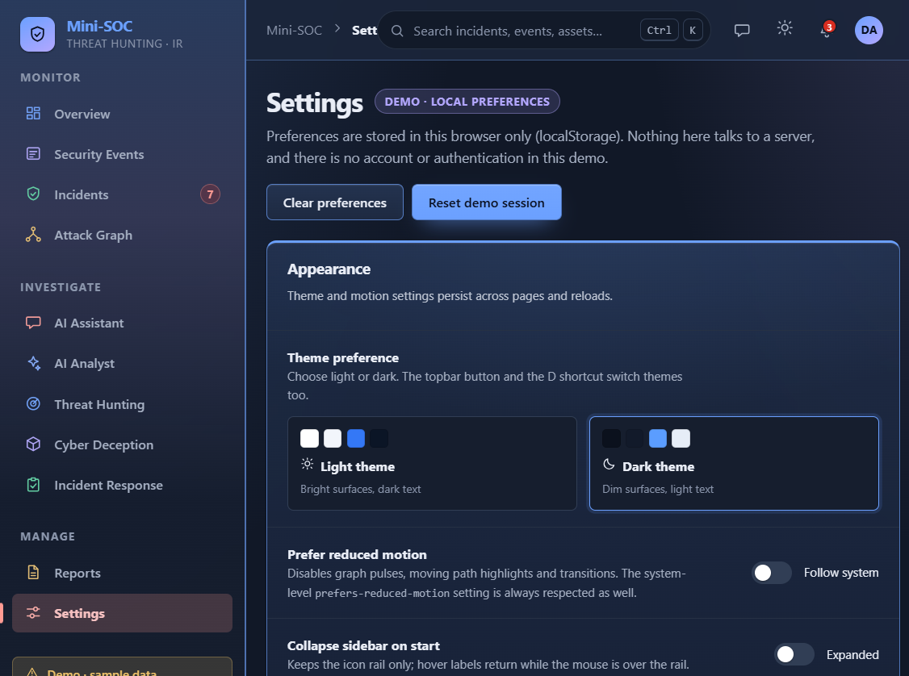

<div align="center">

# Mini-SOC

**A Security Operations Center (SOC) front-end demo — built with HTML5, CSS3 and vanilla
JavaScript only.**

No frameworks · No build step · No backend · No dependencies

[](#tech-stack)
[](#tech-stack)
[](#tech-stack)
[](#tech-stack)
[](#quick-start)
[](#accessibility--quality)
[](#honest-scope)

</div>

> ⚠️ **Everything you see is sample/demo data**, generated locally in the browser. The UI labels
> this wherever it matters and never claims live integrations, real-time feeds or AI inference.
> See [Honest scope](#honest-scope).

---

## Screenshots

| Light theme | Dark theme |
|---|---|
|  |  |



---

## Overview

Mini-SOC is a complete, self-contained SOC console front-end: dashboards, event and incident
tables, an investigation workspace, an interactive attack graph, a local threat-hunting query
engine, deception assets, a response/approval workflow with an audit log, a report builder, a
scripted AI assistant, and a settings surface — **12 pages sharing one application shell**.

It exists to demonstrate front-end architecture, design systems and accessibility *without* a
backend in the way:

- **Runs from `file://`** — classic `<script>` tags, no ES modules, no `fetch()`.
- **One data layer** (`js/services.js`) separates pages from data, so swapping the demo dataset
  for a real REST API is a single-file change.
- **Design tokens drive everything** — colour, spacing, type, motion and the tinted-glass theme
  are defined once in `css/tokens.css` and consumed everywhere else.

---

## Tech stack

| Layer | Technology | Notes |
|---|---|---|
| Markup | **Semantic HTML5** | landmarks, headings, tables with `scope`/captions, 12 thin page shells |
| Styling | **CSS3** | custom properties, `color-mix()`, `backdrop-filter`, Grid + Flexbox, `@media print`, container breakpoints |
| Design system | **Design tokens** | `css/tokens.css` — palette, 6 accent tones, spacing scale, type scale, radii, elevation, motion |
| Logic | **Vanilla JavaScript (ES5)** | classic scripts, no bundler/transpiler, `SOC.*` module namespace + event bus |
| Charts | **Hand-rolled SVG** | `js/charts.js` — area, donut, bar, gauge; redrawn on resize/theme change |
| Attack graph | **SVG + pointer/keyboard model** | `js/network-graph.js` — pan/zoom/pinch, arrow-key/Tab navigation, animated paths |
| Persistence | **Web Storage API** | `localStorage` — theme, motion, sidebar, rows-per-page, chat history (degrades to session-only) |
| File export | **Blob + `<a download>`** | client-side CSV export for events, hunt results and reports |
| Typography | **Self-hosted woff2** | Playfair Display (SIL OFL) for headings/sidebar + system sans for UI text |
| Dev server (optional) | **Node.js, zero dependencies** | `tools/serve.js` (~70 lines) static file server |
| Quality tooling | **axe-core, Lighthouse, custom contrast harness** | automated a11y + WCAG AA colour audits in both themes |

### Under the hood of the CSS

- **Design tokens first.** Components never hard-code a colour or a size; they read
  `--accent`, `--sp-*`, `--fs-*`, `--r-*`, `--shadow-*`, `--t-*`.
- **Coloured-glass UI.** Cards, buttons, panels, fields, the sidebar and the topbar are built
  from one recipe: a radial accent cap + linear wash over a translucent surface, a
  `backdrop-filter` blur/saturate, an accent-mixed border and a full-strength 3px edge line.
- **Theme-adaptive colour.** Tones are aliases (`--tone-blue/violet/teal/amber/rose/indigo`) that
  re-resolve through the light/dark severity palette, so one `.tone-*` class works in both themes.
  `color-mix()` percentages live in intensity tokens (`--glass-cap`, `--glass-line`, `--sub-text`,
  …) with separate day/night values.
- **Contrast by construction.** Secondary text is mixed toward `--text`
  (`color-mix(in srgb, var(--text-3) var(--sub-text), var(--text))`) so it stays ≥ 4.5:1 over
  whichever tint sits behind it; icons/graphics are held to ≥ 3:1.
- **Motion with consent.** All transitions use design tokens; `prefers-reduced-motion` and the
  in-app toggle both disable them.

### Under the hood of the JavaScript

- **No framework, no build.** Ordered classic scripts build a single `SOC` namespace
  (`SOC.services`, `SOC.ui`, `SOC.chat`, `SOC.registerPage`). Ordering matters and is documented.
- **One shell, many pages.** `js/navigation.js` injects the sidebar/topbar/global search into
  `<div id="app-shell">`; each page registers a controller with `SOC.registerPage('data-page-id', init)`
  and `app.js` boots the shell first, then the matching controller inside a `try/catch` that
  renders a readable error card instead of a blank page.
- **Browser APIs used:** `localStorage` (prefs + chat store), `MutationObserver` (dynamic panels),
  `IntersectionObserver` (pauses the attack-graph animation when off-screen), `URLSearchParams`
  (deep links), `Blob`/`URL.createObjectURL` (CSV export), `matchMedia`
  (`prefers-reduced-motion` and `prefers-color-scheme`), `navigator.clipboard`, plus a tiny
  in-memory event bus (`SOC.on`/`SOC.emit`) and delegated keyboard handling for dialogs, drawers
  and popovers. All animation is CSS-driven (`transition`/`@keyframes`) — there is no
  `requestAnimationFrame` loop.

### Why no framework?

The point of the project is the **front-end craft** — tokens, component architecture, SVG
rendering, accessibility and honest states. Keeping it dependency-free makes it:

1. instantly runnable (double-click `index.html`),
2. trivially auditable (every byte is source you can read),
3. framework-agnostic — the DOM/CSS/SVG patterns port to React/Vue/Svelte unchanged.

---

## Architecture

```
mini_soc/
├─ index.html                 # Overview page
├─ pages/                     # the other 11 pages (thin HTML shells)
├─ css/
│  ├─ tokens.css              # design tokens + @font-face; colour, type, spacing, motion
│  ├─ base.css                # reset, typography, utilities, print base
│  ├─ layout.css              # shell: sidebar, topbar, page frame
│  ├─ components.css          # buttons, cards, badges, tables, dialog, toast, inputs…
│  ├─ pages.css               # page-specific compositions (settings, reports…)
│  ├─ chat.css                # AI Assistant: page panel, drawer, transcript, composer
│  └─ responsive.css          # 1024/768/390 breakpoints + print
├─ js/
│  ├─ utils.js                # DOM/format helpers, event bus, page registry, prefs
│  ├─ theme.js                # theme + motion + sidebar persistence
│  ├─ demo-data.js            # env, assets, techniques, events, incidents, series…
│  ├─ demo-scenarios.js       # graph, hunting, decoys, AI analyses, response/audit
│  ├─ services.js             # ← single data-access layer (+ SOC.api placeholders)
│  ├─ components.js           # SOC.ui: badges, KPIs, tables, drawer, dialog, toast…
│  ├─ charts.js               # dependency-free SVG charts
│  ├─ network-graph.js        # pan/zoom SVG graph with animation + a11y keyboard model
│  ├─ navigation.js           # shared shell, global search, popovers, shortcuts
│  ├─ chat-service.js         # SOC.chat: provider adapter, mock provider, chat store
│  ├─ chat-ui.js              # SOC.chatUI: chat view, markdown-lite, history, drawer
│  ├─ app.js                  # boots the shell, then the current page controller
│  └─ pages/*.js              # one controller per page (SOC.registerPage)
├─ fonts/                     # self-hosted Playfair Display (woff2, SIL OFL)
├─ docs/                      # README screenshots
├─ tools/serve.js             # optional zero-dependency static server
└─ README.md
```

**Script order** (classic scripts): `utils → theme → demo-data → demo-scenarios → services →
components → charts → network-graph → navigation → chat-service → chat-ui → <page controller> →
app.js`.

**Data flow:** page controller → `SOC.services.*` → (today) demo dataset / (later) `fetch()` →
same return shapes → `SOC.ui` render helpers → DOM. Pages never read `SOC.demo` directly for
lists/details, which is what makes the backend swap a single-file change.

---

## Quick start

### Option A — open directly (simplest)

Double-click `index.html` (or drag it into a browser). The app runs entirely over `file://`:
classic `<script>` tags, no ES modules, no `fetch()`, fonts/charts/icons local or drawn at
runtime.

### Option B — tiny dev server (optional)

```bash
node tools/serve.js 8080
# then open http://localhost:8080/
```

`tools/serve.js` is a ~70-line static file server with **no dependencies**. It exists only for
convenience and is **not required**.

### Option C — GitHub Pages

The repo is a static site: **Settings → Pages → Deploy from a branch → `main` / root**. Every
page then loads from `<username>.github.io/mini_soc/`.

> Verified in current Chromium-based browsers (no IE/legacy support).

---

## Pages

| # | Page | File | What it demonstrates |
|---|------|------|----------------------|
| 1 | Overview | `index.html` | KPI row, activity/donut/bar charts, attention list, graph preview, timeline, quick links |
| 2 | Security Events | `pages/events.html` | Filterable/sortable/paginated event table, facet counts, detail drawer, CSV export |
| 3 | Incidents | `pages/incidents.html` | Status/severity filters, sortable table with risk bars, detail drawer |
| 4 | Investigation | `pages/investigation.html` | Incident workspace: tabs for overview, evidence, MITRE ATT&CK, timeline, AI panel, hunt findings |
| 5 | Attack Graph | `pages/attack-graph.html` | Interactive SVG graph: pan/zoom/pinch/keyboard, node details, sample attack path, legend |
| 6 | AI Assistant | `pages/ai-assistant.html` | Chatbot with General/SOC-Analyst modes, markdown-lite transcript, history, context chips, contextual drawer (topbar, every page) |
| 7 | AI Security Analyst | `pages/ai-analyst.html` | Analyses split into **Observed fact / Inference / Recommendation**, confidence meters, uncertainty block |
| 8 | Threat Hunting | `pages/threat-hunting.html` | Local query engine (`field:value` + free text + scope filters), saved queries, history, CSV export |
| 9 | Cyber Deception | `pages/deception.html` | Simulated decoy inventory, interaction timeline, detail drawer |
| 10 | Incident Response & Risk | `pages/incident-response.html` | Risk gauge + factors, recommendations with **human approval workflow**, audit log |
| 11 | Reports | `pages/reports.html` | Report builder, section toggles, print view (PDF via browser), CSV export |
| 12 | Settings | `pages/settings.html` | Theme, motion, sidebar, rows-per-page preferences; demo environment info; API placeholder map |

---

## Working with the UI

- **Theme:** light/dark toggle in the topbar, theme cards in Settings, or press <kbd>D</kbd>.
  Persisted in `localStorage` (`soc.theme`), falling back to the system preference.
- **Motion:** Settings → *Prefer reduced motion*; the OS-level `prefers-reduced-motion` setting is
  honoured as well. Graph pulses and path animations pause when the tab is hidden or the stage is
  off-screen.
- **Search:** <kbd>Ctrl</kbd>/<kbd>Cmd</kbd> + <kbd>K</kbd> or <kbd>/</kbd> — searches across
  incidents, events, assets and pages.
- **Shortcuts:** <kbd>Esc</kbd> closes dialogs/drawers/popovers (including the AI drawer and the
  chat history panel); graph nodes are reachable with <kbd>Tab</kbd> and selectable with
  <kbd>Enter</kbd>.
- **Responsive:** designed and checked at 1440 / 1024 / 768 / 390 px widths.

### Deep links (query parameters)

| Page | Parameter | Example |
|------|-----------|---------|
| Events | `?event=` | `events.html?event=EVT-9112` |
| Incidents | `?status=` | `incidents.html?status=Investigating` |
| Investigation | `?id=` | `investigation.html?id=INC-2026-1039` |
| Attack Graph | `?focus=`, `?path=0`, `?incident=` | `attack-graph.html?focus=n-web` |
| AI Analyst | `?id=` | `ai-analyst.html?id=INC-2026-1042` |
| Threat Hunting | `?q=` (saved-query id or free text) | `threat-hunting.html?q=SQ-3` |
| Cyber Deception | `?decoy=` | `deception.html?decoy=DCY-01` |
| Incident Response | `?id=` | `incident-response.html?id=INC-2026-1042` |
| AI Assistant | `?incident=`, `?event=` | `ai-assistant.html?incident=INC-2026-1039` |

---

## Accessibility & quality

- **Standards:** skip link, landmarks, ordered headings, focus-visible rings, focus trapping in
  dialogs/drawers, `aria-live` result counts, `role="log"` chat transcript with a polite status
  region, table captions/`scope`, keyboard-operable filters, tabs and chat controls.
- **Colour:** every text/background pair is measured in **both themes** (a small harness that
  composites the real `background-image` layers and compares computed colours) — body text and
  labels ≥ 4.5:1, icons/graphics ≥ 3:1, over the strongest tint at the top of a pane.
- **Tooling:** axe-core 4.12 — 0 violations on all 12 pages in both themes (plus the open AI
  drawer); Lighthouse audits for Accessibility / Best Practices / SEO.
- **Motion:** everything animated sits behind tokens and is disabled by the reduced-motion toggle
  or the OS setting.

---

## Honest scope

What is implemented **on this demo data**:

- ✅ CSV export — events, hunt results, report data (client-side `Blob` + download link)
- ✅ Print view — Reports → *Print / save as PDF* via the browser print dialog, with dedicated
  `@media print` rules that hide the shell and the builder
- ✅ Local query execution, sorting, filtering, pagination, theming, graph interaction
- ✅ Approval workflow decisions and audit entries (in-memory, this browser session only)
- ✅ AI Assistant chat — full conversation UI with modes, history and retry, persisted locally;
  replies come from a scripted demo knowledge base (labelled *Demo* in the header and per message)

What the UI explicitly does **not** claim:

- ❌ No live log sources, SIEM, EDR, firewall or threat-intel feeds — all data is sample data
- ❌ No AI/LLM is called; the analyst outputs in `js/demo-scenarios.js` are authored sample
  content, labelled *Demo · sample analysis*, and classified as Observed / Inference /
  Recommendation
- ❌ The AI Assistant does **not** call a model either — its header says *Demo provider · no live
  model*, and workspace answers quote only records that really exist in the demo dataset
  (unknown ids get an explicit “can’t find” answer)
- ❌ No response action executes anything — approvals and “simulated execution” only write to the
  local audit log, and sensitive actions require an explicit confirmation dialog
- ❌ No real-time streaming, no notifications, no persistence beyond `localStorage` preferences
  and the local chat history

### AI Assistant (chatbot)

Rendering (`js/chat-ui.js`) is separated from data access (`js/chat-service.js`); both hosts —
the page and the topbar drawer — share one store through the `chat:changed` event.

- **Modes:** *General Assistant* / *SOC Analyst*, persisted in `localStorage`
  (`soc.pref.chatMode`).
- **Provider status:** header chip reads **“Demo provider · no live model”** — replies come from
  a scripted local knowledge base, no keys, no backend, no telemetry.
- **Context:** opening the drawer attaches real context only — `?incident=` / `?event=` / `?id=`
  from the current URL plus the page name, shown as removable chips.
- **History:** new/switch/delete-with-confirm, capped at 20 conversations × 100 messages
  (`soc.chat.store`), falling back to memory when storage is unavailable.
- **Composer:** auto-expanding textarea, <kbd>Enter</kbd> sends, <kbd>Shift</kbd>+<kbd>Enter</kbd>
  adds a line (IME-safe), disabled while a reply is pending.
- **Demo test hooks:** send `/error` for the error bubble + working **Retry**, or `/empty` for the
  honest empty-response state.

---

## Connecting a backend (integration points)

All data access goes through **`js/services.js`** — replacing the demo layer is a single-file
change:

1. `SOC.services.*` functions (`listEvents`, `getIncidents`, `getGraph`, `runHuntQuery`,
   `getAIAnalysis`, `getRecommendations`, …) are the app's internal API: swap their bodies for
   `fetch()` calls while keeping the returned shapes.
2. `SOC.api.endpoints` documents the intended REST surface (rendered in
   **Settings → Backend integration points**):

   | Purpose | Placeholder |
   |---------|-------------|
   | Security events | `GET /api/events` |
   | Incident list / single | `GET /api/incidents`, `GET /api/incidents/:id` |
   | Asset inventory | `GET /api/assets` |
   | Attack graph | `GET /api/graph` |
   | Hunt query execution | `POST /api/hunt` |
   | Deception assets | `GET /api/decoys` |
   | AI analysis per incident | `GET /api/analysis/:incidentId` |
   | Response recommendations | `GET/POST /api/recommendations` |
   | Audit log | `GET/POST /api/audit` |
   | Notifications | `GET /api/notifications` |
   | **AI Assistant chat** | `POST /api/chat` |
   | **Chat conversations** | `GET /api/chat/conversations` |
   | **Chat record context** | `GET /api/chat/context?incidentId=…` |

3. The frontend keeps working over `file://` today: `services.js` resolves these calls
   synchronously from the demo dataset, behind a documented async boundary you can flip to
   promises without touching page code.
4. Real AI output must arrive **classified** (fact vs inference vs recommendation) with source
   references — the AI Analyst layout already renders those labels and the uncertainty block.
5. Real response actions belong behind the existing confirmation/approval flow — the UI already
   treats every action as simulated and requires confirmation for sensitive ones.

### AI Assistant integration (`js/chat-service.js`)

1. `SOC.chat.CONFIG.provider` is `"mock"` today and `"http"` for a real backend. The future
   adapter already exists as `httpSend()`: it POSTs `{ mode, message, conversationId, context }`
   to `POST /api/chat` and expects `{ text }` back (an empty `text` renders the honest
   empty-state bubble; a non-2xx renders the error bubble with a working **Retry**).
2. Conversations stay client-side in `localStorage`; move them server-side by replacing the
   `load()/persist()` bodies with `GET /api/chat/conversations`, keeping the store shape.
3. Record context can be verified server-side via `GET /api/chat/context` — the client only ever
   sends ids it actually saw in the URL, never fabricated ones.
4. **Never put API keys in this frontend** — authentication belongs on the backend; the browser
   should only ever hold a session cookie or a short-lived user token.

---

## Browser support & limitations

- Modern evergreen browsers (Chromium, Firefox, Safari). Shipped code is ES5-compatible — no
  optional chaining, no modules.
- `localStorage` may be unavailable (private mode) — preferences then degrade gracefully to
  session-only behaviour.
- Demo state (status changes, audit entries, hunt history) is in-memory: **reload to reset**.
  Preferences (theme/motion/sidebar/rows-per-page) and AI conversations (`soc.chat.store`)
  persist until deleted.

---

## Typography & credits

- **Playfair Display** by Claus Eggers Sørensen — bundled in `fonts/` under the
  **SIL Open Font License 1.1**; used for headings and the sidebar.
- **Inter** (if installed) with a system sans fallback for UI text — not bundled.
- Everything else in this repository is the author's own code and demo data.

---

## بالعربية

**ميني-سيوك (Mini-SOC)** هو واجهة كاملة لمركز عمليات أمنية (SOC) مبنيّة بـ **HTML5 و CSS3
وجافاسكربت من غير أي مكتبة أو أدوات بناء أو خادم خلفي** — كل البيانات المعروضة بيانات تجريبية
مولّدة محلياً داخل المتصفح، والواجهة بتقول كده في كل مكان من غير أي ادّعاء باتصالات حقيقية أو
ذكاء اصطناعي فعلي.

- **التقنيات المستخدمة:** تصميم قائم على *Design Tokens*، تأثير الزجاج الملوّن
  (`backdrop-filter` + `color-mix()`) مع دعم كامل للثيم الفاتح والغامق، رسوم SVG مكتوبة يدوياً
  من غير مكتبات، رسم تفاعلي للشبكة (Attack Graph) بتحكّم كامل بالكيبورد، وتخزين محلي عبر
  `localStorage`.
- **الجودة:** جميع النصوص والخلفيات مقيسة تباينها وفق **WCAG AA** في الثيمين، وتم فحص الواجهة
  بـ axe-core (صفر مخالفات) مع دعم كامل للوحة المفاتيح وقارئات الشاشة.
- **التشغيل:** افتح `index.html` مباشرة، أو شغّل `node tools/serve.js 8080`.
- **ربط الخلفية:** كل الوصول للبيانات من ملف واحد `js/services.js` — استبدال البيانات التجريبية
  بـ REST API تعديل ملف واحد فقط.
